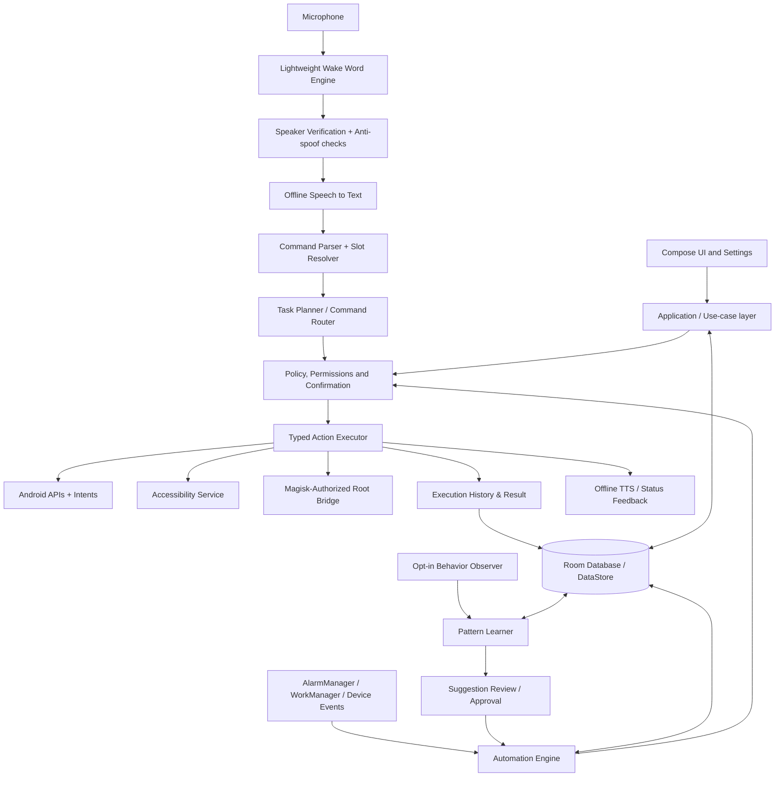

# Zeno — Offline Root-enabled Android Voice Assistant
## System architecture v1.0 — 21 November 2026

**Target hardware:** Google Pixel 4a 5G (`bramble`), Android 14 / API 34.
**Primary design principles:** Fully local voice processing; owner-voice verification; hands-free operation; least-privilege root control; user-controlled automations; battery-aware background operation; accessible, simple Material 3 UI.

> **Scope:** Technical design, not an implementation. Android permissions, always-on operation, wake-word support, and some third-party integrations must be verified with real-device tests. Root does not bypass every Android security boundary.

## 1. Product requirements

| ID | Requirement | Implementation plan | Acceptance test |
|---|---|---|---|
| R1 | User-defined wake phrase | Lightweight offline hotword engine; model preparation/enrollment for selected phrase | Wake from screen-off when OS permits; low false triggers |
| R2 | Respond only to enrolled owner | Local speaker embedding + threshold + optional anti-replay checks | Test owner, unfamiliar speakers, recordings, noisy environments |
| R3 | Offline voice commands | On-device ASR and deterministic command parser with slot filling | Airplane-mode speech and local phone commands |
| R4 | Touchless phone control | Android Intents/APIs, AccessibilityService, app integrations | Call, SMS, screenshot, lock, scroll, tap, launch, voice type |
| R5 | Privileged control | Magisk-supervised, strictly allowlisted root command bridge | Explicitly approved shutdown/restart; no arbitrary shell from speech |
| R6 | Always listening when enabled | Default Android Assistant/VoiceInteractionService + light detector | Screen-off, app-closed and after-boot behavior tested |
| R7 | Restore after reboot | Boot receiver, saved enabled flag, Direct Boot aware minimal state | No unsanctioned re-enabling after user turned it off |
| R8 | Any number of user-defined automations | Rule repository; indexed schedules; flexible action graph | Create, edit, search, filter, duplicate, pause, delete |
| R9 | Scheduled SMS and multi-step routines | Time triggers; contact resolver; SMS gateway; anti-duplicate ledger | One SMS per due execution, with confirmation policy |
| R10 | Adaptive learning (opt-in) | Event observation, lightweight pattern detection, suggestions | No inference-based action without prior approval |
| R11 | Settings are user-controlled | DataStore and per-capability permissions | Save and restore choices; disable anytime |
| R12 | Privacy and recoverability | Encrypted local records, Keystore, audit trail, export/import | Delete profiles, review logs and undo/pause routines |

## 2. Component map



### Voice lifecycle
1. **Standby:** Listening setting is on; only lightweight hotword model continuously processes audio when Android permits.
2. **Wake:** Local wake detector hears custom phrase; audio capture transitions to active session.
3. **Verify:** Speaker model compares against locally enrolled owner voice; an uncertain or rejected match does not execute commands.
4. **Recognize:** Offline ASR turns speech into text, including free-form dictated SMS text.
5. **Understand:** Parser identifies intent, slots, recipient, message, schedule, and follow-up context. Ask if a contact is ambiguous.
6. **Authorize:** Policy engine enforces per-command permissions, confirmation settings, and Android lock-screen authentication rules.
7. **Execute:** Typed action runs through the least-privileged Android API, Accessibility, or root bridge.
8. **Confirm:** Speak outcome (success, failure, or pending confirmation); return to standby.

State machine: `DISABLED -> STANDBY -> WAKE_DETECTED -> VERIFY_OWNER -> LISTEN_COMMAND -> PARSE -> AUTHORIZE -> EXECUTE -> RESPOND -> STANDBY` with error/cancel/time-out edges returning to standby.

## 3. Main subsystems

### Voice subsystem
- **Default assistant:** `VoiceInteractionService` for lightweight ongoing assistant integration, `VoiceInteractionSessionService` for active conversations.
- **Wake word:** Small on-device model chosen after benchmark. User-customizable names need a trained or compatible model; entering text alone is insufficient.
- **Speaker verification:** Enroll varied samples; create encrypted speaker embeddings; compare on wake/command and test against replay. Recognition is probabilistic, not a biometric unlock substitute.
- **Speech-to-text:** Vosk small English model first (~40 MB model, roughly 300 MB memory runtime depending on configuration); load only after wake.
- **Speech output:** Offline `TextToSpeech`; local voice pack must actually be installed for chosen language.
- **Languages:** English first; further languages depend on availability of viable offline models (do not promise Kinyarwanda until tested).

### Command subsystem
- **Intent catalog:** `SEND_SMS`, `READ_SMS`, `CALL_CONTACT`, `OPEN_APP`, `SCREENSHOT`, `LOCK_SCREEN`, `SCROLL`, `TAP`, `DICTATE`, `SET_VOLUME`, `FLASHLIGHT`, `SHUTDOWN`, `REBOOT`, `CREATE_AUTOMATION`, `PAUSE_AUTOMATION`, etc.
- **Entity resolver:** Contacts and aliases ("Mum"), app names, numbers, dates, times, timezone, action arguments.
- **Conversation state:** Multi-turn clarification, e.g., "Text Mum" -> "What message?" -> dictated text -> approval.
- **Typed action registry:** Maps validated intents to specific action classes, not arbitrary interpreted code.
- **Future optional local NLU model:** Only if deterministic parser is insufficient; limit memory usage and battery cost.

### Action subsystem
- **Android gateways:** Android APIs for calls, SMS (with suitable authorization), contacts, notifications, media, settings and app launching.
- **Accessibility gateway:** User-enabled service for navigation and screen-aware interactions; cannot guarantee control of all apps or security surfaces.
- **Root bridge:** Narrow API such as `Shutdown`, `Reboot`, `ApprovedSystemSetting`. Root command templates are internal and allowlisted; validate arguments; never interpolate free-form speech into `su -c`.
- **Result handling:** Structured success, error, retryability and user feedback; avoid silent success claims.

### Automation subsystem
- **Triggers:** One-time schedule, daily/weekly/custom recurrence, battery threshold, charging state, app use events, manually triggered shortcuts; future conditional triggers as supported.
- **Conditions:** Days of week, time window, power/charging, connectivity, phone state, user-disabled flag, and consent requirements.
- **Actions:** Reusable typed action steps. Support ordered multi-action workflows, delays, failures and stop/continue policies.
- **Scheduling:** `AlarmManager` for genuinely exact user-facing times when special access is granted; `WorkManager` for deferrable processing; broadcast receiver for device events. Rebuild schedules after reboot, timezone changes, and edits.
- **Safety:** Store a unique execution ID and last-run result to avoid duplicate SMS after retries or reboot; rate-limit external effects; label failures; distinguish missed from executed runs.
- **Scale:** No hardcoded automation count; indexing, pagination, filtering and lazy loading. Performance and device constraints still apply.

**Example only (not baked in):** Recurring 07:00 SMS to Mum. Actual rule is just data: recipient alias + saved message + daily trigger + confirmation policy + enabled flag.

### Adaptive learning subsystem
- **Default OFF:** No behavior observation or inference until the user enables it.
- **Opt-in sources:** The app's own executed actions, approved usage statistics and high-level accessibility events where applicable. Do not indiscriminately read private message contents.
- **Pattern learning:** Count repeated time/action/context sequences, score regularity; user-configurable threshold (e.g., 5 occurrences) is a heuristic, not a guarantee.
- **Review:** Display suggested trigger, actions, timing, evidence and possible impact. Allow dismiss, edit, approve or block future suggestions.
- **Autonomy:** Only already approved routines execute unattended. Sensitive actions (money transfers, destructive file operations, privileged security changes) require fresh confirmation and/or are forbidden from learned autonomy.
- **Control:** Pause learning, clear training history, delete an individual suggestion or all learned patterns.

### Startup subsystem
- On boot, a receiver reads **non-sensitive** listening intent and scheduler metadata from device-protected storage; it rebuilds allowed schedules.
- A first-unlock event initializes credential-encrypted speaker profiles, contacts, learning data and ASR services.
- `VoiceInteractionService` is the preferred persistent assistant mechanism. Android 14 constrains microphone foreground-service starts from the background, with specific exceptions for voice-interaction services; confirm actual behavior on Pixel 4a 5G.
- Never claim it listens while fully powered off, after Android forcibly stops the app, or when the microphone is blocked. Direct Boot cannot access credential-encrypted owner profile until first unlock.

### Storage subsystem
- **DataStore:** Listening on/off, app preferences, toggles, confirmation policy and sound/UI settings.
- **Room:** `Automation`, `Trigger`, `Condition`, `ActionStep`, `ExecutionLog`, `LearnedPattern`, `Suggestion`, `ContactAlias`, `VoiceEnrollmentMetadata`.
- **Sensitive assets:** Speaker embeddings and other protected records encrypted at rest using Android Keystore-derived protection; never put biometric templates in ordinary logs.
- **Backup:** Optional encrypted local exports of routines/settings. Recovery process must not silently loosen security policies.

## 4. Proposed settings screens

- **Home:** Listening state, offline state, recent actions, pause/resume, quick commands.
- **Commands:** Searchable list, custom command aliases, per-action access.
- **My Automations:** Search, filters (all/active/paused/learned), create, edit, copy, pause, delete, run history.
- **Create Automation:** Name; trigger(s); conditions; ordered action(s); repetition; confirmation policy; error handling; test & save.
- **Learning & Automation:** Master learning toggle (OFF by default), suggest-only/approved execution mode, repetition threshold, learning history, discovered routines.
- **Voice Training:** Enrollment, speaker tests, retrain/reset; anti-replay test and user voice requirement.
- **Background & Startup:** Always listening, screen-off listening, autostart preference, current service health, battery diagnostics.
- **Security & Permissions:** Contact/SMS/accessibility usage, root privileges, sensitive-action approvals, privacy, lock-screen limits.

## 5. Proposed repository / package layout

```text
Zeno/
├── UI Designs/                      # existing screens and prototypes
├── docs/
│   ├── ARCHITECTURE.md
│   └── system-flow.mmd
└── android/
    ├── app/
    │   └── src/
    │       ├── main/
    │       │   ├── java/com/zeno/
    │       │   │   ├── app/         # App entry point / dependency wiring
    │       │   │   ├── ui/          # Compose screens, navigation, viewmodels
    │       │   │   ├── voice/       # assistant service, wake, ASR, speaker, TTS
    │       │   │   ├── commands/    # parsing, intent slots, conversation state
    │       │   │   ├── actions/     # typed commands and Android/root gateways
    │       │   │   ├── automations/ # triggers, schedules, routines, runners
    │       │   │   ├── learning/    # observation, patterns, suggestions
    │       │   │   ├── security/    # permissions, policy, Keystore
    │       │   │   ├── data/        # Room entities, DAOs, DataStore
    │       │   │   └── startup/     # receivers, recovery, rescheduling
    │       │   ├── assets/models/   # downloaded/packaged local AI models
    │       │   ├── res/
    │       │   └── AndroidManifest.xml
    │       ├── test/                # unit tests
    │       └── androidTest/         # device/integration tests
    ├── build.gradle.kts
    └── settings.gradle.kts
```

Start with **one Android app module organized into packages** rather than many Gradle modules. Extract stable modules later if build times or isolation warrant it.

## 6. Permissions and access matrix

| Capability | Access / integration | Notes |
|---|---|---|
| Microphone | `RECORD_AUDIO`, selected assistant integration | Android privacy toggles take precedence |
| Speaker profile | User enrollment + local encrypted storage | Not a replacement for PIN/fingerprint |
| SMS | `SEND_SMS` and suitable handler/authorization; for reading `READ_SMS` when applicable | Google Play distribution has SMS policy restrictions |
| Contacts | `READ_CONTACTS` | Verify intended recipient on ambiguous matches |
| Calls | `CALL_PHONE`; appropriate dialer role for deeper call features | Carrier network still needed |
| Screen navigation | User-enabled `AccessibilityService` | May be blocked on protected screens |
| Notifications | Notification listener permission if enabled | Never observe needlessly |
| App-use learning | Usage access (`PACKAGE_USAGE_STATS`) | Special user-granted access; default OFF |
| Precise actions | Special `SCHEDULE_EXACT_ALARM` access when needed | Often denied by default on Android 14 |
| Reboot/shutdown | Magisk root authorization | Each sensitive root action explicitly controlled |
| Android secure unlock | Android PIN / fingerprint | Voice alone should not bypass secure keyguard |

## 7. Security policy

1. User chooses **owner-only voice** and enrolls samples locally; spoofing remains possible, so do not treat speaker identification as unbreakable authentication.
2. **Never execute shell commands from unconstrained recognized text**; root bridge exposes only compiled, allowlisted actions.
3. New adaptive suggestions require explicit review. All sensitive routines must define a separate consent policy.
4. Confirm the actual contact and message per the user's configured SMS policy; queued sends use stable IDs to prevent duplicates.
5. Maintain concise local logs, opt-in logging of message content, and one-tap emergency stop.
6. Provide secure PIN/fingerprint fallback for protected actions. No voice-only bypass of Android secure lock screen.
7. Background microphone only operates when Android authorizes it, and listening settings remain user-controllable.

## 8. Delivery phases

- **Phase 0:** Project skeleton; Compose navigation; permissions, settings and data models.
- **Phase 1:** Manual microphone activation -> offline STT -> small command parser -> TTS; owner training.
- **Phase 2:** Basic actions: contacts, SMS with configured confirmation, phone lock, screenshot, open apps and navigation.
- **Phase 3:** Default assistant + always-on wake word, screen-off tests, reboot resume, battery profiling.
- **Phase 4:** Secure typed root adapter; Magisk authorization; shutdown/restart actions.
- **Phase 5:** General-purpose automation builder, triggers, reliable scheduling, history and edit/pause/delete.
- **Phase 6:** Opt-in pattern detection and suggestion approval, safe autonomous execution of approved routines.
- **Phase 7:** Reliability, privacy, performance and resilience under phone calls, low battery, Doze and reboot.

## 9. Critical acceptance tests

- Wake while screen is off, after UI exit, after reboot / first unlock, and after user explicitly disables listening.
- Distinguish owner from another person and a playback recording; record false accept and false reject rates.
- Offline operation under airplane mode for actions that do not themselves require cellular/internet.
- Distinguish "Text Mum" from contacts with similar names and confirm correct SIM selection.
- Execute a scheduled action once per occurrence despite reboot, low battery, retry, or app restart.
- Turning adaptive learning OFF stops event recording and new suggestions; turning an automation OFF stops future runs.
- If root is unavailable or revoked, normal phone control continues with clear error feedback.
- Secure-keyguard PIN requirement is respected after restart even with owner verification.

## 10. Official references

- VoiceInteractionService: https://developer.android.com/reference/android/service/voice/VoiceInteractionService
- Android 14 foreground-service restrictions: https://developer.android.com/develop/background-work/services/fgs/restrictions-bg-start
- Direct Boot: https://developer.android.com/privacy-and-security/direct-boot
- AccessibilityService: https://developer.android.com/reference/android/accessibilityservice/AccessibilityService
- AlarmManager: https://developer.android.com/reference/android/app/AlarmManager
- Exact alarms on Android 14: https://developer.android.com/about/versions/14/changes/schedule-exact-alarms
- WorkManager: https://developer.android.com/develop/background-work/background-tasks/persistent
- Vosk Android: https://alphacephei.com/vosk/android
- Vosk models: https://alphacephei.com/vosk/models
- Android SMS policy for Play distribution: https://support.google.com/googleplay/android-developer/answer/10208820
